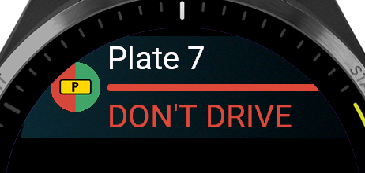

# Pico y Placa Bogotá · Garmin Connect IQ

¿Tu carro tiene pico y placa **hoy** en Bogotá? Mira el reloj.

Widget para el **Garmin Forerunner 965** que, desde la lista de glances, te dice con un color si
puedes salir hoy, y en la vista completa muestra mañana y los próximos días hábiles.

> **English:** Connect IQ widget for the Garmin Forerunner 965 that shows at a glance whether your
> car is restricted today under Bogotá's *pico y placa* rule (odd/even days by last plate digit,
> Colombian holidays computed on the watch). English and Spanish UI.

<p align="center"></p>

---

## Para usuarios

### Qué muestra

**Glance** (al subir y bajar por la lista desde la carátula):

| Color | Texto | Significado |
|---|---|---|
| 🔴 Rojo | **NO SALGAS** / *DON'T DRIVE* | Tu placa tiene pico y placa hoy, de 6:00 a. m. a 9:00 p. m. |
| 🟢 Verde | **PUEDES SALIR** / *OK TO DRIVE* | Hoy puedes circular todo el día. Si es fin de semana, festivo o la medida fue levantada, lo dice. |

**Vista completa** (selecciona el glance con START): el estado de hoy en un círculo grande, el
horario, el estado de mañana y una fila con los próximos 5 días hábiles.

### Regla que aplica

Pico y placa para vehículos **particulares** en Bogotá
([fuente: bogota.gov.co](https://bogota.gov.co/mi-ciudad/movilidad/2026-11/pico-y-placa-en-bogota-para-semana-del-23-al-29-de-noviembre-de-2026)):

- Lunes a viernes, de 6:00 a. m. a 9:00 p. m.
- **Días impares** del mes: circulan las placas terminadas en **1, 2, 3, 4 y 5**.
- **Días pares**: circulan las placas terminadas en **6, 7, 8, 9 y 0**.
- No aplica sábados, domingos ni festivos. El reloj calcula los festivos de Colombia de cualquier
  año (fijos, Ley Emiliani y los que dependen de la Semana Santa).
- **Excepciones:** si la Alcaldía levanta la medida algún día o cambia la rotación temporalmente,
  el reloj se entera solo (descarga una lista una vez al día; ver más abajo).

**No tiene en cuenta:** el pico y placa regional (entrada a Bogotá en puentes), el *Pico y Placa
Solidario* (si lo pagaste, la app igual te dirá que no salgas), ni las reglas de taxis, carga o
servicio especial.

> ⚠️ Esta app no es oficial. Ante cualquier duda, consulta a la Secretaría Distrital de Movilidad.

### Instalar en el reloj

Por ahora la app no está en la tienda Connect IQ: se instala por USB con el archivo `.prg`
(hay que compilarlo; ver [Para desarrollo](#para-desarrollo)).

1. Conecta el reloj al computador con el cable USB. En Windows aparece en *Este equipo* como
   **Forerunner 965** → *Almacenamiento interno*.
2. Copia `PicoPlaca.prg` a la carpeta **`GARMIN\Apps`** del reloj.
3. Desconecta el reloj y espera unos segundos.
4. Desde la carátula, presiona **UP** o **DOWN** para ver los glances. Si no aparece *Pico y
   Placa*, baja hasta el final → **Editar** → **Agregar**.

Para actualizarla, copia el nuevo `.prg` encima del anterior.

### Ajustes (en el reloj)

En la vista completa presiona **START** (o toca la pantalla) para abrir **Ajustes / Settings**:

| Opción | Qué hace |
|---|---|
| **Placa / Plate** | Último dígito de tu placa (0–9). Cámbialo si cambias de carro. |
| **Rotación / Rotation** | Activado = *impares: 1–5 · pares: 6–0* (regla vigente). Desactívalo si la Secretaría invierte la rotación. |
| **Idioma / Language** | Automático (sigue el idioma del reloj), English o Español. |
| **Excepciones / Exceptions** | Muestra cuándo se descargaron por última vez. Selecciónalo para descargarlas ya (requiere el celular conectado). |

Los ajustes se guardan en el reloj. Garmin Connect en el celular solo muestra ajustes de apps
instaladas desde la tienda; con instalación por USB, usa este menú.

---

## Para desarrollo

### Estado del proyecto (noviembre de 2026)

- **v1 — terminada:** regla, festivos, glance, vista completa, menú en el reloj, inglés y español.
  Probada en el simulador del FR965.
- **v2 — implementada, falta probar de punta a punta:** descarga diaria de excepciones. Pendiente:
  activar GitHub Pages y probar con una excepción real (ver [Pendientes](#pendientes-e-ideas)).

### Requisitos

- **Connect IQ SDK** (probado con 9.3.0), instalado con el *SDK Manager* de Garmin. El Manager
  descarga el SDK en `%APPDATA%\Garmin\ConnectIQ\Sdks\`; la versión activa está en
  `%APPDATA%\Garmin\ConnectIQ\current-sdk.cfg`.
- **Perfil del dispositivo `fr965`**: en el SDK Manager → *Devices* → descargar *Forerunner 965*.
- **Java 17+** (por ejemplo `winget install EclipseAdoptium.Temurin.17.JDK`).
- **Python 3** para el validador.
- **OpenSSL** para generar la llave (viene con Git for Windows).

### Llave de desarrollador

`developer_key` firma la app y **no está en git** (`.gitignore`). Si no existe:

```bash
openssl genrsa -out developer_key.pem 4096
openssl pkcs8 -topk8 -inform PEM -outform DER -in developer_key.pem -out developer_key -nocrypt
rm developer_key.pem
```

**Guarda una copia fuera del repo.** Una app firmada con otra llave no puede reemplazar a la
instalada: habría que desinstalarla primero (y se pierden los ajustes guardados en el reloj).

### Compilar, validar y probar

```powershell
# 1. Validar la lógica en Python (festivos 2025–2027, rotación, excepciones y docs/exceptions.json)
python tools/validate.py

# 2. Compilar (ajusta la carpeta del SDK a la tuya)
$sdk = "$env:APPDATA\Garmin\ConnectIQ\Sdks\connectiq-sdk-win-9.3.0-2026-10-20-95888f262\bin"
& "$sdk\monkeyc.bat" -d fr965 -f monkey.jungle -o bin/PicoPlaca.prg -y developer_key -l 2

# 3. Simulador: ábrelo primero y espera a que cargue; luego carga la app
& "$sdk\connectiq.bat"
& "$sdk\monkeydo.bat" bin\PicoPlaca.prg fr965
```

La compilación debe quedar **sin warnings**, también con `-l 3` (verificación de tipos estricta).

En el simulador:
- La app arranca en el glance; **START** (o clic en el glance) abre la vista completa.
- Abajo a la izquierda se ve la memoria usada (el glance tiene un límite de ~60 KB; hoy usa ~9 KB).
- *Settings → Time* cambia la fecha para probar otros días.
- *File → Edit Persistent Storage* permite ver y borrar `Properties` y `Storage`.
- *Simulation → Background Events* dispara el servicio de excepciones.

### Arquitectura

```
source/
  PicoPlacaApp.mc     Clase de entrada: vistas, servicio y eventos (onBackgroundData, onStorageChanged)
  PicoLogic.mc        Fechas, Pascua, festivos, regla, excepciones, ajustes, colores
  PicoGlanceView.mc   Glance: placa, barra de color y estado
  PicoView.mc         Vista completa
  PicoMenu.mc         Menú de ajustes (START): placa, rotación, idioma, excepciones
  PicoService.mc      Servicio en segundo plano que descarga docs/exceptions.json + PicoSync (programación)
resources/            Ícono, textos de Garmin Connect (inglés), ajustes (properties/settings)
resources-spa/        Textos de Garmin Connect en español
docs/exceptions.json  Excepciones publicadas en GitHub Pages
docs/img/             Imágenes del README
tools/validate.py     Misma lógica en Python + pruebas + validador del JSON
```

**Procesos.** Connect IQ ejecuta la app en tres procesos con memoria separada, y la clase de entrada
`PicoPlacaApp` se carga en los tres:

| Proceso | Qué carga | Anotación |
|---|---|---|
| Glance | `PicoGlanceView`, `PicoLogic`, `PicoSync` | `(:glance)` |
| Segundo plano | `PicoServiceDelegate`, `PicoLogic` | `(:background)` |
| App completa | Todo | — |

Las funciones de `PicoPlacaApp` que solo corren en primer plano llevan
`(:typecheck(disableGlanceCheck))` y/o `(:typecheck(disableBackgroundCheck))`. Así la vista completa
y el menú no ocupan memoria del glance ni del servicio, y el compilador no da warnings de ámbito.

**Datos guardados en el reloj:**

| Dónde | Clave | Contenido |
|---|---|---|
| `Properties` | `plateDigit` | Dígito de la placa (por defecto 3) |
| `Properties` | `oddDaysLow` | `true` = días impares circulan 1–5 |
| `Properties` | `language` | 0 automático, 1 English, 2 Español |
| `Storage` | `exc` | `{días desde 1970 → máscara de bits de dígitos con restricción}` |
| `Storage` | `syncOk` / `syncAt` | Época (segundos) de la última descarga correcta / del último intento |

**Fechas.** Toda la aritmética usa enteros (días desde 1970-01-01, algoritmo *days_from_civil*).
Solo se usa `Gregorian.info(Time.now(), FORMAT_SHORT)` para saber la fecha local de hoy. Así se
evitan problemas de zona horaria.

**Estados de un día** (`PicoLogic.status`): `LIBRE`, `PICO`, `FINDE`, `FESTIVO`, `LEVANTADA`.
Orden de prioridad: excepción → fin de semana → festivo → regla par/impar.

### Si cambia la regla

- **Se invierte par/impar:** no hay que tocar código; es el ajuste *Rotación* del menú.
- **Cambio puntual o temporal:** agrega excepciones al JSON (abajo).
- **Cambio permanente de la regla** (otros grupos de dígitos, otro horario, rotación por día de la
  semana): edita `PicoLogic.status` en `source/PicoLogic.mc` **y** `status`/`circulates` en
  `tools/validate.py`, agrega pruebas con fechas reales publicadas por la Alcaldía, valida y
  recompila. El horario aparece como texto en `PicoGlanceView.mc` y `PicoView.mc`.

### Mantener las excepciones

Edita [`docs/exceptions.json`](docs/exceptions.json) y súbelo a `main`. El reloj lo descarga de
`https://mauro014.github.io/pico-placa-bog-ciq/exceptions.json` una vez al día.

```json
{
  "version": 1,
  "updated": "2026-12-01",
  "exceptions": [
    { "date": "2026-12-24", "pico": [], "note": "Medida levantada por Navidad" },
    { "date": "2027-01-04", "pico": [6, 7, 8, 9, 0], "note": "Rotación especial" }
  ]
}
```

- `pico`: dígitos que **tienen** pico y placa ese día; `[]` = medida levantada para todos.
- Una excepción manda sobre todo (incluso fines de semana y festivos).
- `note` es solo para ti; el reloj no la muestra.
- El reloj guarda solo fechas desde ayer, máximo 60. Puedes borrar las fechas pasadas.
- Antes de subir: actualiza `updated` y corre `python tools/validate.py`.

**GitHub Pages** (una sola vez): *Settings → Pages → Source: Deploy from a branch → `main` /
`/docs` → Save*. El archivo `docs/.nojekyll` evita que Pages lo procese.

**Descarga en el reloj:** el servicio (`PicoService.mc`) se programa al abrir el glance o la app:
24 horas después de la última descarga correcta o 1 hora después de un intento fallido. Va a
internet a través del celular (Bluetooth con Garmin Connect). Sin conexión, la app sigue con la
regla normal y las últimas excepciones guardadas.

### Trampas conocidas

- **La carpeta del SDK Manager no es el SDK.** El SDK real queda en `%APPDATA%\Garmin\ConnectIQ\Sdks\`.
- **`monkeydo` falla en silencio** si el simulador no ha terminado de abrir. Ábrelo primero.
- **El simulador recuerda los ajustes** entre ejecuciones (por eso puede mostrar otra placa).
  Bórralos en *File → Edit Persistent Storage*.
- **Monkey C no acepta `++x` dentro de una expresión** (`f(++d)` no compila); usa `d += 1` antes.
- **El compilador exige cada texto en todos los idiomas** del manifest (`resources` y `resources-spa`).
- **Textos que no caben:** `PicoLogic.fit()` prueba la versión larga y, si no cabe, usa la corta.
  Úsalo al agregar textos.
- **El servicio escribe en `Storage` directamente** (permitido en segundo plano desde CIQ 3.2,
  nuestro `minApiLevel`). No escribas en `Storage` desde el glance.
- **GitHub Pages en vez de `raw.githubusercontent.com`:** Pages sirve el JSON como
  `application/json`. `raw` lo sirve como `text/plain`, y el reloj puede rechazarlo cuando pide JSON.
- **Ajustes de Garmin Connect** (`resources/settings/`) solo se ven con instalación desde la tienda;
  el menú del reloj es la vía principal.

### Pendientes e ideas

- [ ] Activar GitHub Pages y probar la descarga con una excepción temporal (simulador y reloj).
- [ ] Publicar el `.prg` en *GitHub Releases* para que otros no tengan que compilar.
- [ ] Publicar en la tienda Connect IQ (así también funcionan los ajustes desde Garmin Connect).
- [ ] Soportar más relojes (agregar productos al `manifest.xml` y revisar el diseño en pantallas
      más pequeñas o rectangulares).
- [ ] Permitir en el JSON cambios de horario o de regla por rango de fechas.
